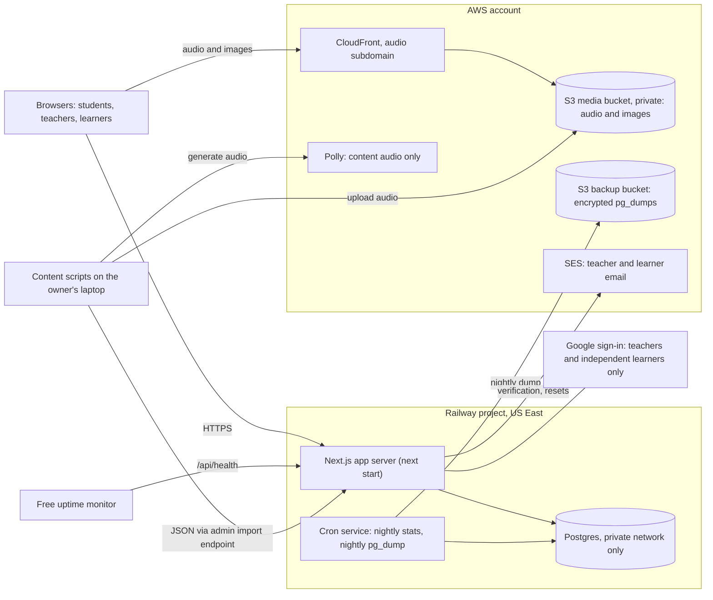

# LenguaLearn: Product Specification

> Source of truth for what to build. Restored from the original CLAUDE.md paste on 2026-10-20: markdown structure added, text unchanged except the renames recorded in [DECISIONS.md](DECISIONS.md).

## Mission

You are building LenguaLearn (working name), a free web app that teaches Spanish vocabulary the way Membean teaches English vocabulary. It has two audiences:

- Independent learners sign up themselves, take a short placement test, and train at their own pace, from total beginner upward.
- Teachers of Spanish classes at any level, from first-year through AP and college, create classes, set weekly training goals, watch progress, and give auto-graded assessments.

The product is one core loop, used in short daily sessions:

1. The student starts a timed session (default 15 minutes).
1. The app introduces a few new words, each with a rich word page, and immediately checks understanding.
1. The app mixes in reviews of words learned earlier, scheduled by a spaced-repetition model so each review lands just before the student would forget.
1. Question types get harder as a word becomes better known: recognize it, then choose it, then use it in context, then produce it from memory.
1. The app tracks only real, attentive time. Idle or random-clicking time is flagged, not counted.

Teachers see minutes trained against the weekly goal, accuracy, words learned, and flagged time for every student. They can export grades and give each student a personalized quiz built from the words that student has studied.

## Non-negotiables

- **Free for everyone.** No ads and no selling data. Hosting costs stay near zero at small scale.
- **Student privacy by design.** Classroom students never give the app their name, email, or any other personal information (see Accounts and privacy). This is also the main way to get past district IT approval.
- **Original content only.** Never scrape, copy, or paraphrase Membean's content, word pages, images, or branding. Membean is a reference for features and feel, nothing more.
- **Accuracy of Spanish content matters more than volume.** A wrong definition teaches a student something false. Every word needs a review path before it goes live (see Content pipeline).

## Decisions

Use these defaults unless I have edited them. If you think one is wrong, say why before starting and wait for my answer. Do not quietly substitute your own choice.

| Area | Default | Reason |
|---|---|---|
| Framework | Next.js (App Router) + TypeScript, strict mode, run as a long-lived Node server (next start) | One codebase for pages and API |
| Styling | Tailwind CSS | Fast to build, consistent, light and dark mode |
| Validation | Zod at every API boundary | Typed input checking |
| Database | Postgres on Railway, same project and region as the app, private network only | Relational data. Fast queries from the same data center |
| ORM and migrations | Drizzle | Typed queries, plain SQL migrations I can read |
| Auth | Better Auth. Username plugin for class students (handle + password). Email/password or Google for teachers and independent learners. Class students never use Google | Battle-tested. Supports accounts with no email |
| Sessions | Stored in Postgres (Better Auth default) | No extra service |
| Rate limiting | Better Auth's built-in limiter, in memory, keyed per handle, per seat code and per device cookie (see Accounts and privacy) | Works on a single server and behind shared school IPs |
| Spaced repetition | ts-fsrs (FSRS-6), two cards per sense: recognition and production | Most accurate open scheduler with a TypeScript library. Move to FSRS-7 when ts-fsrs supports it |
| Audio | Amazon Polly Neural voices, pre-generated, in a private S3 bucket, served through CloudFront on an audio subdomain with long cache headers. Browser speech synthesis as fallback | Same AWS account. Generated once, never per request |
| Images | Pictures for concrete words, stored in S3 next to audio, with source and license recorded per image | Pictures plus the English gloss beat either alone |
| Email | AWS SES, with SPF and DKIM on the domain | Same AWS account as audio and backups |
| Scheduled jobs | Railway cron service: nightly stats job and nightly pg_dump to S3 | Built in. Independent backups |
| Tests | Vitest for logic, Playwright for key flows | The scheduler, answer checking, integrity rules and auth must be tested |
| CI | GitHub Actions, ESLint, Prettier | Type-check and test on every push |
| Hosting | Railway, US East, deploy from GitHub, preview environments for pull requests | No cold starts, cron included, roughly $6–12/month for the pilot |
| Monitoring | Free uptime monitor pinging /api/health, emailing me on failure | I hear about outages before a teacher does |
| UI language | English UI, Spanish content | Target learners are English speakers |
| Dialect | Neutral Latin American Spanish. Mark regional words, don't teach regional differences | Matches most US classrooms |
| Word bank | Ordered by frequency, from the most basic words toward about 10,000. 500 for the pilot, then grown band by band | Covers total beginners through advanced learners |

These are judgment calls where a reasonable person could pick differently:

- **Password hashing.** Better Auth uses scrypt by default. Configure Argon2id or keep scrypt, and explain the choice. Both meet current guidance.
- **One Railway server.** A single server in one region keeps in-memory rate limiting valid and avoids cold starts. An outage there takes the app down mid-class. Acceptable for the pilot.
- **Two cards per sense.** Separate recognition and production strengths double the reviews per word. Check the cost in the simulator before committing.
- **Bank size.** About 10,000 words is a guess at "near-native for reading". Real usage should decide how far past 5,000 the bank grows.
- **Image source.** Openly licensed images, AI-generated images, or both. Ask me before choosing.

## Hosting and infrastructure

Everything that touches student data runs in one Railway project in US East. AWS holds only audio files and encrypted database backups.

> Editor's note: the original diagram was lost when this spec was pasted. This one is reconstructed from the text around it and the Requirements list below.

Student data lives only in Postgres and its backups. Browsers fetch audio straight from CloudFront, and the content scripts reach the app only through the admin import endpoint.

### Requirements

- **One server, one region.** The app server, Postgres, and the cron service run in one Railway project in US East. Postgres accepts connections only on Railway's private network.
- **Rate limits per handle.** School devices share one public IP, so limits key on the handle or seat code, with only a high per-IP ceiling (see Accounts and privacy).
- **School web filters.** The district must allowlist the app domain and the audio subdomain, both listed in the IT data sheet. Test on a school Chromebook on the school network before the pilot.
- **Email.** Teacher and learner verification and password resets go through AWS SES, with SPF and DKIM set on the domain so school mail filters accept them.
- **Content import.** Scripts on my laptop never connect to the database. They upload JSON through the admin-only import endpoint.
- **Backups.** Railway's backups, plus a nightly pg_dump to a separate S3 backup bucket with a set retention window. Restore from an S3 dump once before launch.
- **Private audio bucket.** The S3 audio bucket blocks public access. CloudFront serves it on an audio subdomain with long cache headers.
- **Deploys.** A Railway health check on /api/health gates each new version. Deploy and migrate outside school hours.
- **Uptime monitoring.** A free monitor pings /api/health and emails me on failure.

Railway handles the hardware, operating system, networking, and HTTPS certificates. I handle the code, migrations, environment variables, and checking that backups restore.

## Content model

The unit of learning is a sense, not a spelling. Realizar meaning "to carry out" and la cuenta meaning "the bill" versus "the account" are separate learnable items. Each sense has its own schedule, questions, and statistics. Most words will have one sense at launch. The model must allow more without a migration.

### Tables (minimum)

- **lemma:** headword (aprovechar), part of speech, gender for nouns (m, f, or both, as in el/la estudiante), plural if irregular, frequency rank, notes on irregular verb forms.
- **sense:** belongs to a lemma. Short English gloss (under 8 words, used in answer options), full definition (one plain sentence), frequency rank of this sense, level (see Levels), measured difficulty (decimal, empty until fitted from answers), optional theme tags, register (neutral, formal, informal, regional with region), cognate status, concreteness (concrete or abstract), status, version.
- **cognate status (on sense):** none, true, or false. For true cognates, store the English word and show "Looks like English: \_\_\_" on the word page. For false cognates, store the misleading English word and show a false-friend warning.
- **example:** belongs to a sense. Spanish sentence, the exact surface form of the target word in it (logró) with character offsets, English translation, difficulty, source (human or AI), status. Aim for 4 per sense so cloze questions do not repeat too soon. Sentences for low-level words use only words at or below that level wherever possible.
- **word_part:** morphology for the "ingredients" view. Prefix, root, and suffix pieces with meanings (im- = not, prescindir = do without, -ible = able to be). Optional per lemma. Fill it only when the breakdown genuinely helps a learner. Word families matter more than roots for Spanish.
- **relation:** typed links between senses. Synonym, antonym, same family (aprovechar, provecho, aprovechable), commonly confused with (realizar versus darse cuenta), collocation (tomar una decisión).
- **hook:** memory hook text for a sense, with source and status. Hooks can be mnemonics. They must not state false etymology as fact. Label a made-up association as a mnemonic. Hooks are optional per sense.
- **image:** belongs to a sense. File key, alt text in English, source, license, attribution text, and status. Only for concrete senses at first.
- **audio:** file key for the lemma and for each example, with voice ID and generation date.
- **word_list:** named, ordered sets of senses ("Level 3", "Food and cooking", "AP theme: Global Challenges", or a teacher's custom list). Themes, including AP themes, are optional lists, not the backbone of the bank.

Every content row has a status: draft, ai_checked, approved, live, retired. Only live content reaches students. Edits create a new version. Student history always points at the sense ID, so fixing a typo never resets anyone's progress.

### Levels

There is no fixed scale and no maximum. A sense's level is its frequency rank divided into bands of 500: level 1 is senses ranked 1–500, level 2 is 501–1,000, and so on with no top. Measured difficulty is a separate decimal, fitted later from real answers, and is used to order words within a level and to pick distractors of similar difficulty. Never hard-code a maximum level, and never assume the AP curriculum sits at the top.

### Word page (what the student sees for a new word)

Show these in order. The first five appear on the intro screen, and the rest open with "More about this word".

1. Headword with article for nouns, part of speech, and a play-audio button.
1. Picture, for concrete senses that have one, shown beside the short gloss. Never instead of the gloss.
1. Short gloss in large type, then the full definition.
1. Two example sentences, target word highlighted, English translation muted below, each with audio.
1. Memory hook, when the sense has one.
1. Cognate note: "Looks like English: \_\_\_" for true cognates, or the false-friend warning.
1. Word family: related forms and synonyms as tappable chips. A chip opens that word's page if it is in the bank.
1. Word ingredients, when the lemma has them: the morphology breakdown as a small visual of labeled pieces.
1. Usage notes: register, common collocations, key irregular forms for verbs.

Spanish-specific details to handle correctly everywhere:

- Nouns always display with their article. Gender is part of knowing the word.
- Accents and ñ are part of spelling, and words are always displayed with their accents. How strictly a typed answer is graded on accents grows with the word's production strength (see Answer checking).
- Reflexive verbs display with -se (quejarse).
- Adjectives show masculine and feminine forms when irregular.

## Learning engine

Put all engine logic in a pure TypeScript module (/lib/engine) with no database or UI imports, so it can be unit-tested and simulated. The UI and API call into it.

### Placement

A new independent learner first picks "I'm a total beginner" or "I know some Spanish". Beginners start at level 1 with no test. Everyone else takes a 3-minute calibration: about 40 items shown one at a time with the question "Do you know this word?" (yes or no). About 10 of the items are made-up Spanish-looking pseudowords. Saying yes to pseudowords lowers the score, which corrects for overclaiming. This is the LexTALE-Esp method. Items are drawn across frequency bands so the test works for any level, and adapt toward the band where answers start to change. The result sets a starting level and seeds the learner's ability score (see Level score). Words well below the starting level are marked as probably known and checked with harder questions instead of being taught. Class students take the same test on first login unless their teacher sets their level, and teachers can override any student's level.

### Session

A session has a timer, 15 minutes by default. When time runs out, the session ends after the current question. Students can end early. Every attentive minute still counts.

The next item is chosen each time, not planned all at once:

1. Any item missed in this session that is due to come back (3–5 items after the miss).
1. A new word's second check, 4–6 items after its intro.
1. The due review with the lowest predicted recall.
1. A new word, if the new-word gate is open.
1. If nothing is due and the gate is closed, the review closest to its due date. The student is never idle.

**New-word gate.** Open when the last 10 answers are at least 75% correct, fewer than 20 reviews are overdue, and fewer than 8 new words have been introduced this session. Close it otherwise. Tune these numbers with the simulator (see Build phases).

### New word flow

- Show the word page with two buttons: Got it and I already know this.
- Got it leads straight to an easy recognition question.
- I already know this leads to a production question (typed or cloze). If it is correct, schedule the word as known (FSRS rating Easy) and skip the rest of the intro. If it is wrong, show the word page again and continue as a new word. The student is never penalized for trying.
- The second check comes 4–6 items later, as a different question type.

**Guess first.** For true cognates and words built from parts the student already knows (desempleo, inolvidable), show the word alone first and ask for its meaning as a multiple-choice question, before the word page. Right or wrong, the word page follows. The guess counts as a pretest, not a review: it is logged but does not change the FSRS cards.

### Scheduling

Use ts-fsrs. Each student–sense pair has two FSRS cards: a recognition card (understand the Spanish) and a production card (produce the Spanish from the meaning). A new word starts with only the recognition card. The production card is created once recognition stability reaches 3 days, a starting value to tune in the simulator. Each question updates only the card it tests: meaning questions and listening questions update recognition, English-to-Spanish and typed questions update production. Map each graded answer to a rating:

| Outcome | Rating |
|---|---|
| Wrong, or "I don't know" | Again |
| Correct but slow (slower than this student's 80th-percentile time for that question type), needed the hint, or missed an accent | Hard |
| Correct | Good |
| Correct and fast on a typed or cloze question | Easy |

Multiple-choice answers never earn Easy, because a guess succeeds 25% of the time. Use FSRS short-term learning steps for in-session repeats, so reviewing a word three times in one session does not look like three days of evidence. I am not certain how ts-fsrs handles same-day reviews in its current version. Read its docs and confirm how it behaves before building on it.

**Fitting parameters.** Start with FSRS default parameters. Once the answer log holds enough reviews (start with 50,000, then monthly), fit parameters to LenguaLearn learners with the optimizer in @open-spaced-repetition/binding, using de-identified data only. Fit one shared set first; per-learner parameters come later, once individual learners have thousands of reviews. Keep the parameter set in the database with a version, and log which version scheduled each answer.

Define learned as passing a recognition review at an interval of at least 7 days, with current predicted recall of at least 85%. Show this definition to teachers wherever the count appears.

### Question types

Question type depends on how well the student knows the word, based on FSRS stability. Early reviews test recognition and later ones test production. Within a band, vary the type and never use the same type twice in a row for one sense.

| Band | Question types |
|---|---|
| New or stability under 2 days | Spanish to English, pick the meaning (4 options) · hear the word, pick the meaning |
| 2–10 days | English to Spanish, pick the word · cloze, pick the word to fill the gap · synonym or antonym match · gender (for nouns) |
| Over 10 days | Type the word from its meaning · typed cloze · pick the sentence that uses the word correctly (3 sentences, 2 misuse it) · hear a sentence, type the missing word |

Every question has an I don't know option. Choosing it counts as Again, with no penalty to the integrity score (see Integrity). This discourages guessing.

The band for a question comes from the stability of the card it tests: recognition questions use the recognition card's stability, production questions use the production card's. A new production card starts with English-to-Spanish multiple choice, then moves to the typed types as its own stability grows. Contrast questions: once both senses in a "commonly confused" relation have a production card, occasionally show a sentence and ask which of the two fits. These count as reviews for both senses.

### Distractors

Wrong options must be plausible and must not also be right.

- Use the same part of speech, a similar level, and a similar gloss length.
- Never use a synonym, a same-family word, or a "commonly confused" word as a distractor for a meaning question. Two options could both be right.
- For cloze questions, options must fit the sentence grammatically. Each example stores 3 reviewed distractor surface forms (such as logró against alcanzó, aportó, superó). If an example has none, fall back to dictionary forms with the note "The answer may be conjugated."
- Log which distractor each wrong answer picked. That shows which confusions to target and which distractors are broken.

### Answer checking for typed answers

- Trim, lowercase, and collapse spaces. Articles are optional for nouns, but a wrong article counts as a gender mistake: rated Hard, with the note "Right word, it's la huella."
- Accents are graded more strictly as a word gets stronger, and the correct spelling is always shown. While the production card's stability is under 21 days, a missing or wrong accent counts as fully correct. From 21 days, it counts as correct but rated Hard, with the note "Watch the accent: *difícil*". Once the word is learned, an accent that changes the meaning (*papa* for *papá*, *esta* for *está*) counts as wrong. Keep the thresholds in the engine config.
- A missing ñ counts as wrong, because it changes the word (año versus ano).
- For words of 6 or more letters, one typo counts as "Almost" (rated Hard). This does not apply if the typo spells a different word in the bank.
- In typed cloze, typing the dictionary form when the sentence needs a conjugation (lograr for logró) counts as "right word, wrong form" (rated Hard), and the form is shown.
- Put every rule behind a single function with a table of test cases, at least 40, before building UI on top of it.

### Feedback after each answer

- **Correct:** a one-line confirmation plus one example sentence with audio. Continue with Enter.
- **Wrong:** show the correct answer, the student's choice labeled with its meaning ("alcanzar means to reach"), and the core word page. Required reading time is 3 seconds before Continue is enabled.
- **Keyboard:** 1–4 picks options, Enter continues, and Space plays audio. Everything also works by touch.

### Level score

Compute two numbers from the start, even before any game elements exist:

- **Ability score (internal).** An Elo-style rating for each learner, updated after every graded answer against the sense's measured difficulty: the further the result is from what the rating predicted, the more both move. It seeds from placement and drives placement, starting levels, and fitting measured difficulty.
- **Estimated vocabulary size (shown to the learner).** The sum of current recall probability across all studied senses, plus an estimate for unstudied words from the ability score and the frequency curve, rounded to the nearest 10: "You know about 2,340 Spanish words."

Show vocabulary size on the learner's home screen and progress page. Do not show it on the teacher dashboard or in grade exports unless I decide otherwise later. Leaderboards and other game elements built on it are not in version 1.

## Accounts and privacy

Classroom students are known to the app only by an anonymous handle. The teacher, not the app, knows which handle belongs to which student.

### Roles

- **Teacher:** email and password with email verification, or Google sign-in. Can only see classes they created.
- **Class student:** no email and no name. Created by redeeming a seat code. Never offered Google sign-in, because a school Google account would send the app the student's real name and school email.
- **Independent learner:** username and password, or Google sign-in. Email is optional for username accounts and used only for password reset. Sign-up requires confirming the user is 13 or older.
- **Admin:** me. Content review and moderation only. Admins cannot browse student data through the UI.

### Class student flow

1. The teacher creates a class and picks a number of seats (1–40, and more can be added later).
1. The app creates one single-use seat code per seat, 8 characters from an alphabet without look-alike characters (no 0/O, 1/I/l), shown as K7QM-4TPX.
1. The teacher downloads a CSV with columns seat, code, student name. The name column is blank. The teacher fills it in their own spreadsheet, and the app never sees it.
1. The student goes to /join, enters the code, and is given a random handle (quiet-otter-42). They set a password and write the handle down. The code is now spent.
1. The student logs in with handle and password from then on.

- **Forgotten password:** the teacher clicks Reset on that seat and gets a new one-time code. The student redeems it and sets a new password. Progress is kept.
- **Changing classes:** a student who already has an account can redeem a seat code in another class while logged in. The same account and history are linked to the new seat.
- **Local-only name labels.** On the teacher dashboard, a teacher may type a name next to each seat. Store these labels only in that browser's localStorage. Never send them to the server, and offer export and import of the labels as a file so they can move to another computer. Show a clear note: "Names stay on this computer. LenguaLearn never receives them." Write a Playwright test that watches every network request while labels are edited and fails if a label string appears in any of them.

### What the app stores

| Data | Kept | Purpose |
|---|---|---|
| Handle, password hash | Until the account is deleted | Sign-in |
| Teacher and learner email (and Google account ID, if used) | Until the account is deleted | Sign-in, verification, password reset |
| Class membership and seat number | Until the class is deleted | Teacher dashboard |
| Answer events and session times | Class data: until 30 days after the class is deleted or the district agreement ends. Learner data: until the account is deleted | Scheduling, dashboards |
| Raw typed answers (max 40 characters) | 90 days, then only how each was graded is kept | Answer checking review |
| Device cookie (random signed ID) | 90 days | Counting failed logins per device |
| IP address | Not stored. In memory only, for rate limiting. Kept out of request logs where the host allows | Abuse prevention |

No third-party analytics, ads, trackers, or externally loaded fonts. Use next/font so fonts are self-hosted. No social features between students: no chat, and no leaderboards.

### Deletion and export

- A teacher can delete a class. Before deleting, offer an export of the class data. Deletion removes seats and unlinks students. Class students with no other class have their accounts and data deleted after 30 days.
- A district can ask for deletion of one student, one class, or all its data. Support each with an admin action that completes within 30 days, and log that it was done.
- Any student or learner can download their own data as JSON and delete their account from settings.
- Deleted data ages out of the nightly S3 backups within the backup retention window (see Hosting and infrastructure). State that window in the privacy policy.
- Class data is used only to run the app and, de-identified, to improve it (fitting FSRS parameters, finding bad items). It is never used for marketing and never sent to an AI or TTS provider.

## Security requirements

- Rate limiting. A school's devices usually share one public IP address, so a whole class logging in at once must not look like one attacker. Rate-limit login and seat-code redemption per handle or seat code, for example 10 attempts per 15 minutes, and per device cookie, for example 30 failed attempts per 15 minutes. Do not fingerprint browsers. Keep a per-IP limit only as a high ceiling, a few hundred attempts per 15 minutes. Write a test where 30 students log in from one IP within a minute and all succeed.
- Session cookies: HTTP-only, Secure, SameSite=Lax. Check the Origin header on every state-changing request.
- Every teacher query is scoped by teacher ID in one shared helper, not by hand in each route. Write tests showing that teacher A cannot read teacher B's class through any API route.
- Validate all input with Zod at the API boundary.
- Admin routes, including the content import endpoint, require the admin role and are covered by the same authorization tests.

## Documents to write

Write these in plain language in /docs:

- A privacy policy, including the retention schedule above and a written data retention policy as the amended COPPA rule requires.
- A one-page "For school IT" data sheet. It lists exactly what is stored and how deletion works, and names every outside service: Railway (app and database, US East), AWS S3 and CloudFront (audio, images and encrypted backups, no student data in the media bucket), AWS SES (teacher and learner email only), Amazon Polly (content audio only, never student data), and Google sign-in (teachers and independent learners only). It also lists the exact domains the district must allowlist: the app domain and the audio subdomain.
- An accessibility conformance report (a VPAT) against WCAG 2.1 AA, which districts request under the ADA Title II web rule.
- A COPPA notice for schools, used only if a class includes students under 13. Also a one-page incident plan: who to notify, within what time, and how, if student data is ever exposed.

I will use the data sheet when asking districts for approval. Neither document is legal advice. Mark in both what needs a lawyer or district review. Design for FERPA, COPPA, the Tennessee Student Online Personal Protection Act (Tenn. Code 49-1-708) and the Florida Student Online Personal Information Protection Act (Fla. Stat. 1006.1494). Tennessee districts usually ask vendors to sign the TN-NDPA through the Student Data Privacy Consortium; make sure nothing in the app would prevent signing it, and list anything that might as an open question.

## Teacher features

A teacher's week should take under 5 minutes in the app: check the dashboard and export grades. Everything else is set once.

### Class settings

- Name, and a weekly goal in minutes (default 45).
- Week boundary: the day and time goals reset, in the teacher's time zone (default Sunday 11:59 pm).
- Session length (default 15 minutes).
- Optional focus list, such as an AP theme or a custom list. Words from it are introduced first.
- Starting level per student: from placement, or set by the teacher.

### Seats

- Add seats, see which codes are redeemed, reset a seat, remove a seat.
- CSV download of codes, as in Accounts and privacy.
- A printable page of cut-out cards, 8 per sheet. Each card has the join URL, the seat code, and a blank line for the student to write their handle.

### Dashboard (one row per seat)

| Column | Detail |
|---|---|
| Seat and label | Seat number plus the local-only name label, if set |
| Minutes this week | Bar against the goal. Counts only minutes that are not flagged |
| Flagged minutes | Shown separately. Links to the integrity detail |
| Accuracy this week | Percent correct on graded questions |
| Words learned | Total, plus the number gained this week |
| Last active | Relative time |
| Status | Chip: On track, Behind, Not started, or Flagged |

Above the table, show a class summary: how many students are on track, the median minutes, class accuracy, and a week picker for past weeks. The table sorts by any column.

### Student detail

- Minutes per day for the last 4 weeks.
- Accuracy trend.
- Current level.
- Words learned and words in progress.
- The 10 most-missed words.
- A list of integrity events with times.

### Class insights

The 15 words this class misses most, each with its most-chosen wrong answer. This tells the teacher what to reteach. The page links to a printable word list.

### Grade export

CSV for a chosen week or date range with columns: seat, handle, minutes, goal, percent of goal, accuracy, flagged minutes, and a suggested grade.

The grade formula is set by the teacher from simple parts: a weight on percent of goal (capped at 100%), a weight on accuracy, and an optional deduction per flagged minute. Show a live preview of the result for the class before export.

### Assessments (after the pilot)

The teacher creates an assessment. They set a title, the number of questions (10–40), an open and close window, an optional time limit, and a source:

- Personalized: each student gets questions drawn from the words they have learned or are learning, weighted toward learned words.
- Fixed list: the same words for everyone.

Questions use the mid and late question types, with no feedback during the test. Each student gets one attempt. Leaving the tab is logged, not blocked.

Grading is automatic. The teacher sees each student's score and item-by-item results, and can drop a bad item for the whole class, which regrades everyone.

Students see their results and corrections after the window closes.

Assessment answers count as reviews for scheduling, applied when the student submits.

## Student experience

The home screen gets a student into training in one tap. Everything else is secondary.

- **Home:** a large Start training button, weekly minutes against the goal as a ring, estimated vocabulary size, accuracy this week, and any open assessment as a card above the button. Independent learners set their own weekly goal.
- **Session:** the timer shows as a thin progress bar and minutes left. No score counter during the session, which keeps the focus on the words.
- **Session summary:** active minutes, questions answered, accuracy, new words introduced, and each word seen with its results. There is a note if any time was flagged, with the reason in one sentence.
- **My words:** a searchable list of every word studied, with a state chip (New, Learning, Learned, Due) and a small strength meter for recognition and production. Opening a word shows its full page in browse mode, which does not affect scheduling.
- **Progress:** estimated vocabulary size over time as a line chart, words learned per level, and minutes per week as bars.
- **Settings:** change password, audio autoplay on or off, theme, join another class, export data, delete account.
- **Tone:** calm and grown-up. The users are high schoolers and adults. Use no mascots, confetti, or streak-guilt messages. A small "days trained this week" count is fine.

## Integrity

Teachers grade on minutes, so minutes must mean attentive practice. The app counts active time only, and it flags time that looks like guessing or idling as flagged minutes, shown separately. It never accuses a student. It shows the pattern and lets the teacher decide.

### Active time

- Time counts only while a question or feedback screen is showing and the tab is visible.
- Each screen counts for at most 60 seconds (90 seconds for typed questions). Time beyond that is not counted.
- After 2 minutes with no input, pause the session and show "Still there?" with a Resume button. Paused time never counts.
- Only one active session per account. Opening a second tab pauses the first.

### Flagged time

Flag a stretch of answers when any of these hold:

- Three or more answers in a row faster than the minimum reading time, with accuracy under 50% across those answers. Minimum reading time is 1.0 seconds for a 4-option meaning question, scaled up with the amount of text on screen.
- The same option position chosen 6 or more times in a row while wrong.
- The tab was hidden while a question was open, then answered within 2 seconds of returning.

When a stretch is flagged, the student sees a single gentle note: "You're answering very quickly. Slow down so this time counts." Choosing I don't know is never flagged.

All thresholds are starting guesses. Store them in one config file. Once real data exists, check them against answer-time distributions and adjust.

### Server-side checks

The client measures response time, but the server must not simply trust it.

- The server issues each question with a signed token containing the question ID and issue time.
- An answer must include a valid, unused token.
- The server compares the client-reported time with its own issue and receive times. It rejects answers with impossible timing and uses the server time when the two disagree by more than 2 seconds.

This stops simple scripts from farming minutes. It will not stop a determined cheater, and it does not need to.

## Content pipeline

Content is the bottleneck, not code. Build the pipeline early and run it in parallel with the app (see Build phases). The goal is the 500 most frequent senses fully reviewed before any student sees the app, then growth one 500-word level at a time toward about 10,000.

Steps 1–3 and 6 are scripts in /scripts/content that run on my laptop. They never connect to the production database. They write JSON files, which I upload through an admin-only import endpoint in the app. The endpoint validates every row with Zod and loads it as draft or ai_checked content, so nothing skips the status flow. Student data never goes to any AI or TTS service.

### 1. Word list

Build a frequency-ranked lemma list from an openly licensed source. Check and record the license of any list before using it. Do not copy a commercial frequency dictionary. Start from the very first words: basic nouns, adjectives and verbs (la casa, grande, tener) are in. Leave out only articles, prepositions, pronouns and conjunctions as standalone cards at first; students meet them in example sentences. That cut is my judgment, so list what you dropped. Very common words have many senses (tener, dar), so teach only the senses that are common at that word's level and add others at higher levels. Tag candidates with optional themes. Level comes from frequency rank. Output: content/candidates.csv, which I will edit by hand before generation.

### 2. Generation

A script calls the Claude API with a strict JSON schema for each lemma. The output covers:

- senses to teach, with gloss, definition, register, cognate status, and concreteness
- 4 examples, each with target surface form, offsets, translation, and 3 cloze distractor forms; for low levels, sentences built only from words at or below that level
- a memory hook only when a good one exists, labeled mnemonic or etymology
- word family, and morphology only where it helps
- collocations and commonly confused words
- for concrete senses, a one-line description of an image that would show the meaning unambiguously

Run in resumable batches, keep every raw response for audit, and print a cost estimate before any large run.

### 3. Independent check

A second model from a different provider reviews each generated field without seeing the first model's reasoning. It returns pass or fail with a reason for each field. It also writes its own short gloss for comparison.

Automatic checks run too:

- The surface form appears at the stored offsets.
- The surface form is a valid inflection of the lemma. Use a conjugation library or table, after spot-checking its accuracy.
- Sentences are 20 words or fewer.
- No cloze distractor also fits the sentence (checked by the second model).
- No duplicate examples.

A sense that passes everything moves to ai_checked. Anything else goes to the review queue with the failures listed.

### 4. Human review

An admin review tool inside the app, built for speed. I should be able to approve a clean word in under a minute.

- A queue filtered by status and failure type.
- Each sense shown exactly as a student would see its word page and questions.
- Inline editing.
- Approve and Reject (with a reason) buttons, plus keyboard shortcuts.
- A reviewer role so volunteer Spanish teachers can review without admin access.

### 5. Feedback loop

- Every question has a "Report a problem" link, with a short reason menu and optional text.
- A sense with 3 or more open reports stops being introduced to new students until it is reviewed.
- The nightly stats job flags items with unusual statistics: accuracy far below other items at the same level, one distractor taking over half of wrong answers, or very long response times. Flagged items go to the review queue.

### 6. Audio

A script generates audio with Amazon Polly Neural voices for each lemma and example, normalizes loudness, and uploads it to the private S3 media bucket. Use one voice for headwords and a different voice for sentences, both Latin American. Before generating the first 500 words, produce the same 10 sentences in two or three candidate voices so I can pick. Support regenerating a single word's audio when a reviewer flags a pronunciation.

### 7. Images

Only concrete senses get an image at first. For each, use the image description from generation to find or create a picture that shows the meaning without text in it. Record source, license and attribution for every image, and keep a reviewer approval step like any other content. Ask me which source to use (an openly licensed library, AI generation, or both) before building this step. Images are optional: a sense without one still goes live.

## Data and quality requirements

### Answer event log

Every graded answer is one append-only row in answer_event, never updated or deleted except by account deletion. Record:

- user, sense, example, and session
- question type, option IDs in display order, chosen option, and typed text (capped at 40 characters; raw text dropped after 90 days, keeping how it was graded)
- correct flag and FSRS rating
- FSRS state before and after
- client response time, server issue and receive times
- flagged marker and app version

This log is the most valuable data the project will have. It allows fitting FSRS parameters to real students later, finding bad items, and checking whether the app works.

### Admin analytics (after the pilot)

One admin page with:

- daily and weekly active users
- sessions and median active minutes
- 4-week retention by sign-up week
- item statistics: accuracy by question band, median time, distractor pick rates, and first-review accuracy for senses with and without a memory hook, to test whether hooks help
- a calibration chart of FSRS predicted recall against actual recall, in 10 bins, per parameter version

### Non-functional

- **Speed.** Serve the next question in under 150 ms of server time. Prefetch it while the feedback screen shows, so the student never waits.
- **No lost answers.** Queue answers in the client and retry on network failure. A dropped Wi-Fi connection or a deploy mid-session must not lose work.
- **Devices.** School Chromebooks (1366×768) are the main classroom device. Phones at 390px width are the main independent-learner device. Test both.
- **School networks.** Before the pilot, load the app and play audio on a real school Chromebook on the school network. District web filters often block unfamiliar domains.
- **Accessibility.** WCAG 2.1 AA. Mark Spanish text with lang="es" so screen readers pronounce it correctly. Use visible focus states, support reduced motion, and make tap targets at least 44px. Every image needs English alt text, and no question may depend on seeing an image alone.
- **Theme.** Light and dark mode.
- **Reliability.** Confirm what Railway's Postgres backups cover on my plan. Independently, the nightly cron runs pg_dump to the S3 backup bucket with a set retention window. Restore from an S3 dump into a fresh database once before launch.
- **Deploys.** Configure a Railway health check on /api/health so a new version takes traffic only once it is ready. Deploy and run migrations outside school hours in the pilot school's time zone.
- **Monitoring.** A free uptime monitor pings /api/health and emails me on failure. The health endpoint checks the database connection and returns no user data.
- **Error tracking.** Ask me before adding Sentry or similar. If used, it must scrub all user identifiers.
- **Code quality.** ESLint, Prettier, and a GitHub Actions workflow that runs type-checking and tests on every push. Keep secrets in Railway environment variables and a local .env, with a committed .env.example.

## Build phases

Build in this order. Stop at the end of each phase and wait for me. Start the content pipeline (Phase 9) right after Phase 2, alongside the other phases, because human review of words is the slowest part of the project.

**Pilot scope.** The first goal is a pilot with one real class plus a small group of independent learners, built together. Build phases 0–7, run Phase 9 until the first 500 senses are live, then do the pilot items in Phase 10. Defer until after the pilot: Phase 8 (assessments), images (Phase 9 step 7), and the admin analytics page.

| Phase | Build | Done when |
|---|---|---|
| 0. Setup | Next.js, TypeScript, Tailwind, Drizzle, Railway project with Postgres, Vitest, Playwright, CI, /api/health, CLAUDE.md, docs/SPEC.md, docs/DECISIONS.md | A hello page deploys to a Railway preview environment, the health check passes, and CI runs green |
| 1. Content schema | All content tables including levels and images, the admin JSON import endpoint, the 40 words from reference/prototype.html as seed data, a read-only word page at /word/[id] | Every word page section renders from the database |
| 2. Engine | The pure engine module: two-card scheduling wrapper, next-item choice, question builder, distractor rules, answer checker with progressive accents (40+ test cases), ability score and vocabulary-size estimate. A simulator runs 100 synthetic learners for 60 days, starting from both total beginners and intermediate learners, and reports new words per day, review backlog, and minutes per learned word | Tests pass. I have read the simulator report and agreed the numbers are sensible |
| 3. Training UI | Session timer, new word flow with guess-first, all question types, feedback screens, keyboard controls, session summary, answer event logging, client retry queue, with one hard-coded dev user | I can train for 15 minutes on a phone and a Chromebook-size window without a bug |
| 4. Accounts | Teacher, class student and independent learner accounts: Better Auth with the username plugin, Google sign-in for teachers and learners, email verification and reset through AWS SES, seat codes, handles, reset codes, device-cookie rate limits, deletion, export | Authorization tests pass. The name-label network test passes. 30 logins from one IP within a minute all succeed |
| 5. Teacher tools | Classes, seats, CSV, printable cards, goals, starting levels, dashboard, student detail, class insights, grade export | I can run a fake class of 25 seeded students through a simulated week and export grades |
| 6. Integrity | Active time, idle pause, flagged-time detection, signed question tokens, server timing checks | Scripted fast-clicker and idle tests produce the expected flags |
| 7. Placement and learner home | Beginner choice and adaptive calibration test, starting level, learner home, goals, vocabulary size on home and progress | A total beginner and an intermediate learner each go from sign-up to first question in under 5 minutes, at sensible levels |
| 8. Assessments (after pilot) | Creation, personalized and fixed sources, taking, grading, item drop, results | A seeded class takes an assessment end to end |
| 9. Content pipeline | Candidate list, generation, second-model check, automatic checks, admin review tool, reviewer role, reports, nightly stats flags, Polly audio upload to S3. Images after the pilot | The first 500 senses reach live status through the full pipeline |
| 10. Launch prep | Pilot items: privacy policy with retention schedule, school IT data sheet with allowlist domains, CloudFront audio subdomain, nightly pg_dump to S3 with a tested restore, uptime monitor, school-network test on a real Chromebook. Before public launch: landing page, accessibility audit and conformance report, load test at 300 simultaneous students | A pilot with one real class and independent learners for 2 weeks with no data loss, then public launch |

> Editor's note (2026-10-20): `reference/prototype.html` does not exist. The Phase 1 seed set will be proposed in the Phase 1 plan instead. See [DECISIONS.md](DECISIONS.md).

After each phase, give me:

- a short summary of what was built
- exact steps to test it by hand
- anything you skipped or were unsure about
- any change to the spec you would recommend

## Roadmap after the pilot

Do not build anything in this section until I start that phase. It is here so early design choices leave room for it. After the pilot, finish Phase 8 (assessments) and Phase 9 step 7 (images) first, then continue in this order. Each phase ends with the same report as above.

| Phase | Build | Done when |
|---|---|---|
| 11. Fitting and analytics | The admin analytics page, FSRS parameter fitting from the answer log, the hook comparison, and tuning integrity and new-word-gate thresholds from real answer times | Fitted parameters predict recall better than the defaults on held-out reviews, and I have read the analytics |
| 12. Coverage check | A learner pastes up to 2,000 characters of Spanish and sees the percent of its words they know, plus the unknown words with an "add to study" button. The pasted text is processed in memory, never stored, and never sent to an AI provider. Ask me before choosing a lemmatizer library | A news paragraph returns a result in under 2 seconds, and unknown inflected forms map to the right dictionary words |
| 13. Reading passages | Passages of 3–4 sentences per level, written only from words at or below the reader's level plus one or two new ones, each with one comprehension question. Generated and reviewed through the content pipeline like any other content | 20 reviewed passages per level for the first three levels, served only to learners whose known words cover them |
| 14. Audio-only sessions | A session type where every question is heard, not read: hear the word or sentence, pick the meaning. Large tap targets, playable with the screen dimmed | A learner can finish a 5-minute session using only audio and taps |
| 15. Sentence practice | For learners above level 6: cloze questions across many reviewed example sentences for words already learned, to build speed in context | Advanced test learners report it is harder than regular reviews but fair |
| 16. Level-score extras | Optional goals and milestones on estimated vocabulary size for independent learners ("Next milestone: 3,000 words"). Nothing competitive, and nothing shown to class students unless their teacher turns it on | Learners can turn it off completely, and no class student sees it by default |

Later, and only after a separate decision: school rostering integrations, AI conversation practice for adult learners who opt in, native mobile apps, and other languages.

## How to work with me

- **First response.** Read this whole spec and reference/prototype.html. Then ask up to 10 clarifying questions in one message, most important first. After I answer, propose a plan for Phase 0 and Phase 1 only. Write no code before I approve that plan.
- **One phase at a time.** Stop at the end of each phase with the report described in Build phases. Do not start the next phase until I say so.
- **Tests first for logic.** The engine, answer checker, integrity rules, rate limits, and authorization checks get tests before any UI is built on them. A phase with failing tests is not done.
- **Keep the docs current.** Update CLAUDE.md with setup and run commands, the architecture, and where things live. Record every decision that goes beyond this spec in docs/DECISIONS.md with a one-line reason.
- **Handle ambiguity openly.** When the spec is unclear, pick the simplest option consistent with it, record it in DECISIONS.md, and tell me in the phase report. For anything touching privacy, grading, or money, ask first.
- **Few dependencies.** Justify each new package in one line. Prefer the platform and small libraries.
- **Help me understand the code.** I am a college CS student who wants to own this codebase, not just receive it. Briefly explain non-obvious design choices in each phase report. Add comments where the reason is not clear from the code. No comments that repeat what the code says.
- **No Spanish content in code.** All words, examples, and hooks go through the content tables and the status flow. Test fixtures are the only exception, and they are marked as fixtures.
- **Never weaken the privacy rules to make something easier.** If a feature seems to need personal data, stop and ask.
- **Small commits with clear messages.** Never commit secrets.

## Not in version 1

- Everything in Roadmap after the pilot, until I start that phase.
- Native mobile apps. The web app must work well on phones instead.
- School rostering integrations such as Google Classroom, Clever, or Canvas. These are how most districts connect apps, but they bring student names into the app.
- Google sign-in for class students, for the same reason.
- Video clips on word pages.
- Grammar lessons, conjugation drills, speaking practice, and AI conversation practice.
- Leaderboards and anything else that ranks students against each other.
- Redis or multiple app servers. Revisit only if one server stops being enough.
- Paid plans.
- Languages other than Spanish. Do not generalize the code for other languages yet.
- Co-teachers sharing a class.
